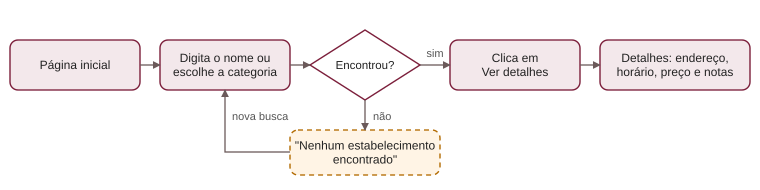
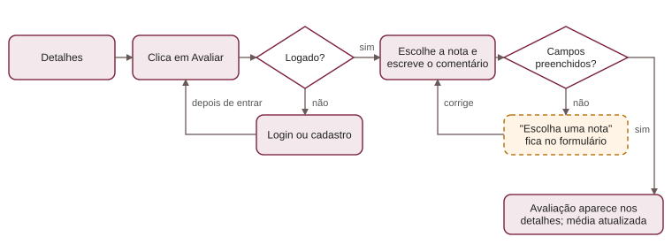
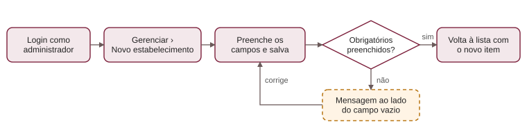

# PRD v2: Guia Gastronômico de São Luís

UFMA · CCET · Engenharia da Computação · Desenvolvimento de Sistemas Web (EECP0036) · Turma 24N12 · 2026.2 · Prof. Renan Sousa Freire

Repositório: https://github.com/PACELLE/guia-gastronomico-sao-luis

Siglas: RF = requisito funcional; RNF = requisito não funcional; S1 = protótipo; S2 e S3 = sprints 2 e 3; depois vem a entrega final.

## 1. Visão e problema

**Contexto.** São Luís recebe turistas o ano todo e tem uma culinária própria (arroz de cuxá, torta de camarão, peixada, juçara), espalhada entre o Centro Histórico, a orla e os bairros. Quem chega à cidade, e mesmo quem mora nela, escolhe onde comer por indicação de conhecidos, por perfis de redes sociais ou por buscas genéricas em mapas.

**Problema.** As informações sobre os restaurantes ficam espalhadas e incompletas: o endereço está num lugar, o horário em outro, a faixa de preço quase nunca aparece, e as opiniões vêm misturadas com propaganda. Não há um lugar único, focado em São Luís, onde dê para comparar estabelecimentos por categoria e ver o que outras pessoas acharam.

**Proposta de valor.** Um guia web, no navegador do celular ou do computador, que lista os estabelecimentos de São Luís com endereço, horário, faixa de preço e categoria, permite buscar e filtrar, e mostra a nota média dada por usuários cadastrados.

**Público-alvo (personas).** As personas abaixo são suposições da equipe, ainda não validadas em entrevista; serão conferidas com pessoas do público durante o protótipo e as sprints.

| Persona | Quem é | O que precisa | Como resolve hoje |
|---|---|---|---|
| Marina, 34 anos | Turista de Belo Horizonte, passa 4 dias em São Luís, usa só o celular | Achar perto do Centro Histórico um lugar de comida típica com preço moderado | Pergunta na recepção do hotel e procura no Instagram |
| Carlos, 22 anos | Estudante da UFMA, morador do Cohama, orçamento apertado | Comparar opções baratas por categoria e saber o que outros acharam | Grupos de mensagens e indicação de colegas |
| Rafael, 29 anos | Administrador do guia, responsável por manter o catálogo | Cadastrar e corrigir estabelecimentos e categorias sem mexer no código | Não existe ferramenta: hoje editaria o banco à mão |

## 2. Objetivos e métricas

| Objetivo | Como medir | Meta |
|---|---|---|
| Encontrar um estabelecimento rapidamente | Número de cliques ou toques da página inicial até a tela de detalhes, usando a busca | No máximo 2 |
| Avaliar sem esforço | Cliques ou toques da tela de detalhes até a avaliação salva, com o usuário já logado | No máximo 4 |
| Informação completa | Estabelecimentos cadastrados com endereço, horário, faixa de preço e categoria preenchidos | 100% (o formulário do administrador não salva sem esses campos) |
| Funcionar no celular | Tela de 360 px de largura sem rolagem horizontal | Nenhuma rolagem horizontal em nenhuma tela |

## 3. Escopo

**Entra:** listar, buscar por nome e filtrar por categoria os estabelecimentos; ver detalhes; cadastro de usuário, login e logout; avaliar com nota de 1 a 5 e comentário; editar e remover a própria avaliação; nota média por estabelecimento; área do administrador para cadastrar, editar e excluir estabelecimentos e categorias; link para abrir o endereço num mapa externo.

**Não entra (não objetivos):** mapa interativo dentro do site e busca por proximidade (geolocalização); reservas, pedidos ou delivery; pagamentos; login com Google ou redes sociais; envio de fotos pelos usuários; recuperação de senha por e-mail; aplicativo nativo para celular.

## 4. Requisitos funcionais

Prioridades: **essencial** (sem ele o produto não faz sentido), **importante** (melhora muito) e **desejável** (bom ter). São 14 RFs, dos quais 8 são essenciais.

Dados de exemplo usados nos critérios (fictícios): estabelecimentos "Casa do Cuxá" (Comida Típica), "Sabor da Ilha" (Comida Típica) e "Peixaria Ponta d'Areia" (Frutos do Mar); usuária "Marina Costa" (marina@exemplo.com).

| RF | O sistema deve… | Prioridade | Critério de aceite (como testar) |
|---|---|---|---|
| RF01 | listar os estabelecimentos cadastrados, com nome, categoria e nota média | essencial | Com os 3 estabelecimentos de exemplo no banco, abrir a página inicial: aparecem 3 cartões, cada um com nome, categoria e nota. Com o banco vazio: aparece "Nenhum estabelecimento cadastrado". |
| RF02 | permitir buscar estabelecimentos por parte do nome, sem diferenciar maiúsculas e minúsculas | essencial | Buscar "cuxá" mostra só "Casa do Cuxá". Buscar "PEIXARIA" mostra só "Peixaria Ponta d'Areia". Buscar "xyz" mostra "Nenhum estabelecimento encontrado". |
| RF03 | filtrar os estabelecimentos por categoria | importante | Com 2 de Comida Típica e 1 de Frutos do Mar, clicar em "Frutos do Mar" mostra só 1 cartão; clicar em "Todos" volta a mostrar 3. |
| RF04 | mostrar os detalhes de um estabelecimento: descrição, endereço, horário, faixa de preço, categoria e avaliações | essencial | Clicar em "Ver detalhes" da Casa do Cuxá abre uma tela com os 6 itens preenchidos. Abrir o endereço de um estabelecimento que não existe (id 999) mostra "Estabelecimento não encontrado". |
| RF05 | permitir que um visitante crie uma conta com nome, e-mail e senha | essencial | Cadastrar "Marina Costa", "marina@exemplo.com" e senha "sol12345", repetida em "Confirmar senha": a conta é criada e a tela de login mostra "Conta criada. Faça login.". Repetir o mesmo e-mail: aparece "E-mail já cadastrado" e nada é criado. Senha com menos de 6 caracteres: aparece "A senha precisa ter pelo menos 6 caracteres". |
| RF06 | permitir que o usuário entre no sistema com e-mail e senha | essencial | Entrar com marina@exemplo.com e a senha certa: volta à página inicial com "Olá, Marina" no topo. Senha errada: aparece "E-mail ou senha incorretos" e o usuário continua sem login. |
| RF07 | permitir que o usuário logado avalie um estabelecimento com nota de 1 a 5 e comentário | essencial | Logada, Marina dá nota 4 com o comentário "Ótima torta de camarão": a avaliação aparece nos detalhes com nome e data. Sem login, clicar em "Avaliar" leva à tela de login. Enviar sem escolher nota: aparece "Escolha uma nota de 1 a 5" e nada é salvo; o mesmo vale sem comentário. |
| RF08 | permitir que o administrador cadastre, edite e exclua estabelecimentos | essencial | Logado como administrador, cadastrar "Sabor da Ilha": ele aparece na lista. Mudar o horário para "11h às 23h": os detalhes mostram o novo horário. Excluir e confirmar: some da lista; cancelar: nada muda. Salvar sem endereço: aparece "Informe o endereço". Um usuário comum que abre a área do administrador recebe "Acesso negado". |
| RF09 | permitir que o administrador cadastre, edite e exclua categorias | importante | Criar a categoria "Lanches": ela aparece no filtro da página inicial. Excluir uma categoria que tem estabelecimentos: aparece "Categoria em uso" e nada é excluído. |
| RF10 | permitir que o usuário edite ou remova apenas a própria avaliação | essencial | Marina muda a nota de 4 para 5: os detalhes mostram 5 e a média é recalculada. Marina remove a avaliação e confirma: ela some. Na avaliação de outro usuário, Marina não vê os botões "Editar" e "Remover"; se tentar pela API, o servidor responde "Acesso negado". |
| RF11 | mostrar a nota média e o número de avaliações de cada estabelecimento | importante | Com as notas 4, 5 e 5, aparece "4,7 (3 avaliações)". Sem avaliações, aparece "Sem avaliações ainda". |
| RF12 | permitir que o usuário saia da conta (logout) | importante | Clicar em "Sair": volta à página inicial e o link "Entrar" reaparece. Depois disso, clicar em "Avaliar" leva à tela de login. |
| RF13 | oferecer um link que abre o endereço do estabelecimento num mapa externo | desejável | Nos detalhes da Casa do Cuxá, clicar em "Ver no mapa" abre o Google Maps numa nova aba já com o endereço pesquisado. |
| RF14 | permitir ordenar a lista pela maior nota média | desejável | Com médias 3,5, 4,8 e 4,2, escolher "Melhor avaliados" mostra a ordem 4,8, 4,2, 3,5. |

**Regras de negócio** (da v1, valem para os RFs acima):

1. A nota de uma avaliação vai de 1 a 5, número inteiro.
2. Só usuário logado avalia.
3. O usuário só altera ou remove a própria avaliação.
4. Só o administrador gerencia estabelecimentos e categorias.
5. Cada usuário faz no máximo uma avaliação por estabelecimento; para mudar de opinião, edita a que já fez. (Nova na v2.)

## 5. Requisitos não funcionais

| RNF | Requisito mensurável |
|---|---|
| RNF01 · Responsividade | Todas as telas funcionam nas versões atuais de Chrome e Firefox, no computador e no celular, sem rolagem horizontal em 360 px e em 1280 px de largura. |
| RNF02 · Segurança de autenticação | A senha é guardada só como hash bcrypt (custo 10 ou maior), nunca em texto puro no banco ou nos logs. A sessão usa cookie HttpOnly e expira após 2 horas sem uso. As consultas ao banco usam parâmetros (sem montar SQL com texto digitado). |
| RNF03 · Controle de acesso | Toda rota de gerenciamento confere no servidor se o usuário é administrador: usuário comum recebe resposta 403 e visitante sem login é levado à tela de login. A interface não é a única barreira. |
| RNF04 · Usabilidade | Da página inicial aos detalhes de um estabelecimento: no máximo 2 cliques. Todo erro de formulário aparece em português, ao lado do campo, sem apagar o que já foi digitado. |
| RNF05 · Persistência de dados | Usuários, estabelecimentos, categorias e avaliações ficam no PostgreSQL. Teste: cadastrar uma avaliação, reiniciar o servidor e conferir que ela continua lá. |
| RNF06 · Acessibilidade | Checklist da disciplina: todo campo com `label` ligado; uso completo pelo teclado; foco visível; link "Pular para o conteúdo"; contraste de texto de pelo menos 4,5:1; nenhuma informação só por cor (a nota aparece em número, não só em estrelas coloridas). |
| RNF07 · Privacidade | O sistema guarda só nome, e-mail e hash da senha do usuário. Nas avaliações aparece apenas o primeiro nome; o e-mail nunca é exibido para outros usuários. Nenhum dado é enviado a terceiros. |
| RNF08 · Segurança básica | Todo texto digitado por usuários é exibido com `textContent` (nunca `innerHTML`). Senhas do banco e a chave de sessão ficam num arquivo `.env`, fora do repositório. |
| RNF09 · Desempenho | Com 50 estabelecimentos no banco, a página inicial mostra a lista completa em menos de 2 segundos num notebook comum, medido na aba Rede do navegador. |

## 6. Histórias de usuário

| História | Critério de aceite | RF |
|---|---|---|
| Como Marina, quero ver a lista de restaurantes logo ao abrir o site, para ter uma ideia das opções sem precisar me cadastrar. | Sem login, a página inicial mostra os cartões com nome, categoria e nota. | RF01 |
| Como Marina, quero buscar um restaurante pelo nome que o recepcionista me indicou, para achá-lo rápido. | Buscar "cuxá" leva à Casa do Cuxá; da página inicial aos detalhes, no máximo 2 toques. | RF02 |
| Como Carlos, quero filtrar por categoria, para comparar só os lugares de comida típica. | O filtro "Comida Típica" mostra só os estabelecimentos dessa categoria. | RF03 |
| Como Marina, quero ver endereço, horário e faixa de preço antes de sair do hotel, para não encontrar o lugar fechado ou caro demais. | A tela de detalhes mostra os três itens preenchidos. | RF04 |
| Como Carlos, quero criar uma conta com e-mail e senha, para poder avaliar os lugares onde comi. | Com dados válidos, a conta é criada; e-mail repetido mostra "E-mail já cadastrado". | RF05, RF06 |
| Como Carlos, quero dar uma nota e escrever um comentário, para ajudar outros estudantes a escolher. | Logado, a avaliação com nota 4 e comentário aparece nos detalhes. | RF07 |
| Como Carlos, quero corrigir minha avaliação depois de voltar ao restaurante, para que a nota reflita minha opinião atual. | Ao mudar a nota de 4 para 5, a nova nota e a média recalculada aparecem. | RF10 |
| Como Marina, quero ver a nota média de cada lugar, para decidir rápido entre duas opções. | Com as notas 4, 5 e 5, aparece "4,7 (3 avaliações)". | RF11 |
| Como Rafael, quero cadastrar um restaurante novo pelo site, para manter o guia atualizado sem mexer no código. | Logado como administrador, o estabelecimento salvo aparece na lista. | RF08 |
| Como Rafael, quero ter certeza de que usuários comuns não alteram o catálogo, para que as informações sejam confiáveis. | Um usuário comum que abre a área do administrador recebe "Acesso negado". | RF08, RNF03 |

## 7. Fluxos principais

Os 3 fluxos centrais (1, 2 e 4) estão desenhados abaixo; o fluxo 2 também aparece no diagrama de sequência (anexo A) e nas telas do protótipo (S1). Caixas tracejadas são mensagens de erro.

**Fluxo 1 · Encontrar um restaurante:** Página inicial → digitar parte do nome na busca (ou escolher uma categoria) → clicar em "Ver detalhes" → tela de detalhes com endereço, horário, faixa de preço e avaliações. Se nada for encontrado, a lista mostra "Nenhum estabelecimento encontrado".



**Fluxo 2 · Avaliar:** Detalhes → "Avaliar estabelecimento" → se não estiver logado, vai para Login (ou Cadastro, se não tiver conta) e volta aos detalhes depois de entrar → escolher a nota e escrever o comentário → "Enviar" → a avaliação aparece nos detalhes e a média é atualizada. Sem nota ou sem comentário, a tela mostra "Escolha uma nota de 1 a 5" (ou pede o comentário) e não sai do formulário.



**Fluxo 3 · Editar a própria avaliação:** Detalhes → na própria avaliação, "Editar" → mudar nota ou comentário → "Salvar" → a avaliação e a média são atualizadas. "Remover" pede confirmação antes de apagar.

**Fluxo 4 · Administrador cadastra um estabelecimento:** Login como administrador → "Gerenciar" → "Novo estabelecimento" → preencher nome, categoria, endereço, horário, faixa de preço e descrição → "Salvar" → volta à lista do administrador com o novo item. Campo obrigatório vazio: a tela mostra a mensagem ao lado do campo e não salva.



## 8. Dados

O modelo segue o diagrama de classes da v1. A classe Administrador, que herda de Usuário, é guardada na mesma tabela de usuários com o campo `perfil`. A nota média não é guardada: é calculada a partir das avaliações (média das notas).

| Entidade (tabela) | Campos | Regras |
|---|---|---|
| Usuário (`usuarios`) | `id` (número), `nome` (texto, obrigatório), `email` (texto, obrigatório, único), `senha_hash` (texto), `perfil` ("usuario" ou "admin"), `criado_em` (data e hora) | E-mail não se repete; senha só como hash |
| Categoria (`categorias`) | `id` (número), `nome` (texto, obrigatório, único) | Não é excluída se tiver estabelecimentos |
| Estabelecimento (`estabelecimentos`) | `id` (número), `nome`, `descricao`, `endereco`, `horario` (textos), `faixa_preco` ("$", "$$" ou "$$$"), `imagem` (endereço da imagem, opcional), `categoria_id` (liga a Categoria) | Nome, endereço, horário, faixa de preço e categoria obrigatórios |
| Avaliação (`avaliacoes`) | `id` (número), `usuario_id` (liga a Usuário), `estabelecimento_id` (liga a Estabelecimento), `nota` (inteiro de 1 a 5), `comentario` (texto, obrigatório), `data` (data e hora) | Nota entre 1 e 5; um par usuário + estabelecimento só aparece uma vez; ao excluir o estabelecimento, suas avaliações são excluídas |

Relações: uma Categoria tem 0 ou mais Estabelecimentos; um Estabelecimento tem 0 ou mais Avaliações; um Usuário faz 0 ou mais Avaliações.

**Onde ficam guardados:** as quatro tabelas ficam no banco PostgreSQL do servidor. O navegador não guarda dados do sistema; guarda só o cookie da sessão de login.

## 9. Arquitetura e tecnologias

| Camada | Escolha |
|---|---|
| Front-end | HTML5, CSS3 e JavaScript puro, sem frameworks |
| Back-end | Node.js (versão LTS atual) com Express |
| Banco de dados | PostgreSQL |
| Comunicação | API REST com JSON |
| Padrão | Monolito em camadas (MVC): um único servidor Express entrega as páginas e responde à API |

**Decisão e justificativa.** O sistema precisa de contas de usuário, de regras de permissão (só o dono edita a avaliação; só o administrador mexe no catálogo) e de dados compartilhados entre todos os visitantes. Por isso não basta o `localStorage`: é preciso um servidor e um banco. Escolhemos JavaScript nas duas pontas para que todos os seis integrantes consigam trabalhar em qualquer parte do código, e o PostgreSQL porque os dados são relacionais (usuário, avaliação, estabelecimento, categoria) e precisam de regras como "nota de 1 a 5" e "e-mail único" garantidas pelo próprio banco. Um único servidor (monolito) é mais simples de rodar e de publicar do que front-end e API separados.

**Bibliotecas:** `express` (servidor e rotas), `pg` (acesso ao PostgreSQL), `bcrypt` (hash de senha), `express-session` (sessão de login), `dotenv` (lê o `.env`).

**Organização das pastas:**

```
public/        páginas HTML, CSS e JS do navegador (a "View")
src/routes/    rotas da API (o "Controller")
src/models/    consultas ao banco (o "Model")
db/            script de criação das tabelas e dados de exemplo
docs/          PRD, relatórios das sprints e diagramas
```

**Principais rotas da API:**

| Método e caminho | O que faz | Quem pode |
|---|---|---|
| `GET /api/estabelecimentos?busca=&categoria=` | Lista, busca e filtra | Todos |
| `GET /api/estabelecimentos/:id` | Detalhes e avaliações | Todos |
| `POST /api/usuarios` | Cria conta | Visitante |
| `POST /api/login` · `POST /api/logout` | Entra e sai | Todos |
| `POST /api/estabelecimentos/:id/avaliacoes` | Cria avaliação | Usuário logado |
| `PUT /api/avaliacoes/:id` · `DELETE /api/avaliacoes/:id` | Edita ou remove avaliação | Dono da avaliação |
| `POST`, `PUT`, `DELETE /api/estabelecimentos` e `/api/categorias` | Gerencia o catálogo | Administrador |

**Publicação.** Para o "link funcionando" das sprints, o sistema será publicado num serviço com plano gratuito que rode Node.js e PostgreSQL (por exemplo, Render). Para desenvolver, cada integrante roda o servidor e o banco no próprio computador, seguindo o passo a passo do README.

## 10. Plano de sprints

**8 RFs essenciais** (RF01, RF02, RF04, RF05, RF06, RF07, RF08 e RF10). Mínimo da S2: 25% de 8 = 2. Mínimo da S3: 60% de 8 = 4,8, arredondado para cima = 5. Entrega final: os 8. O plano abaixo põe uma folga de 1 RF em cada sprint.

| Sprint | RFs | Responsáveis (nomes) |
|---|---|---|
| S1 · protótipo (entregue) | 5 telas em HTML e CSS, sem lógica: lista, detalhes, login, cadastro e avaliar (commit `b4f0828`) | Pacelle Henrique e Victor Cabral (telas) · Rhaynon (relatório) |
| S2 · 3 essenciais (mínimo 2) | RF01, RF02, RF04 (+ servidor Express, tabelas do banco e dados de exemplo) | RF01: Pedro Augusto e João · RF02: Pacelle Henrique e Victor Cabral · RF04: Tereza Clarice e Rhaynon |
| S3 · 6 essenciais acumulados (mínimo 5) | RF05, RF06, RF07 | RF05: Pedro Augusto e Tereza Clarice · RF06: João e Pacelle Henrique · RF07: Victor Cabral e Rhaynon |
| Entrega final · 8 essenciais | RF08, RF10 (+ RF03, RF09, RF11 e RF12; RF13 e RF14 se der) | RF08: Pacelle Henrique e Pedro Augusto · RF10: Tereza Clarice e João · RF03 e RF11: Victor Cabral e Rhaynon · RF09 e RF12: Pedro Augusto e Tereza Clarice |

## 11. Riscos e dependências

| Risco | O que faremos |
|---|---|
| Login e permissões são a parte mais difícil e ficam para a S3 | Começar a estrutura de sessão na S2 e testar o RNF03 (usuário comum recebe 403) logo que o login existir |
| Seis pessoas no mesmo repositório geram conflitos no Git perto do prazo | `git pull` antes de começar; um ramo por RF e pull request revisado por um colega; cada dupla em arquivos próprios; push até a sexta-feira da semana da entrega |
| Um integrante sai da equipe ou fica sem tempo | Todo RF tem dois nomes no plano; commits pequenos e frequentes para o outro continuar de onde parou |
| Senha do banco ou chave de sessão enviada ao GitHub por engano | Arquivo `.env` no `.gitignore` desde o primeiro commit; o repositório guarda só um `.env.exemplo` sem valores reais |
| Busca falha com acentos ("cuxa" não acha "Cuxá") | Comparar sem diferenciar maiúsculas e minúsculas e testar com nomes acentuados; tratar acentos como melhoria se der tempo |
| Banco gratuito do serviço de publicação expira ou fica lento | Guardar no repositório o script que recria as tabelas e os dados de exemplo, para republicar em minutos |
| Dados dos restaurantes errados ou desatualizados | Usar dados de exemplo identificados como fictícios nas sprints; antes de cadastrar estabelecimentos reais, conferir endereço e horário em fonte oficial |

## 12. Equipe e versão

**Integrantes:**

| Nome completo | Papel na equipe |
| --- | --- |
| João Gabriel de Oliveira Lopes | Back-end e banco de dados (Express e PostgreSQL) |
| Pacelle Henrique Parnaíba Sobral | Repositório e front-end |
| Pedro Augusto Sousa Noleto | Back-end e banco de dados (Express e PostgreSQL) |
| Rhaynon Carvalho Soares | Documentação, relatórios e entregas |
| Tereza Clarice da Silva Rocha | Back-end e banco de dados (Express e PostgreSQL) |
| Victor Eduard Rodrigues Cabral | Front-end e CSS |

Os responsáveis por cada RF estão no plano de sprints (seção 10), com dois nomes por RF.

**Repositório:** https://github.com/PACELLE/guia-gastronomico-sao-luis

**Histórico de mudanças:**

| Versão | O que tinha ou mudou |
|---|---|
| v1 | Mapeamento de funcionalidades, entidades e regras de negócio; 8 RFs com prioridade Alta ou Média; 5 RNFs só com nome; diagrama de classes; diagrama de sequência do fluxo de avaliação; escolha de tecnologias; fluxo de uso em 8 passos. |
| v2 | Estrutura de 12 seções da disciplina. RFs: de 8 para 14 (+RF09 gerenciar categorias, separado do RF08; +RF10 editar e remover a própria avaliação; +RF11 nota média; +RF12 logout; +RF13 ver no mapa; +RF14 ordenar por nota). Prioridades convertidas para essencial, importante e desejável, com critério de aceite em todos os RFs. RNFs: de 5 para 9, todos mensuráveis (+RNF06 acessibilidade, +RNF07 privacidade, +RNF08 segurança básica, +RNF09 desempenho). Nova regra de negócio: uma avaliação por usuário por estabelecimento. Novas seções: visão e personas, objetivos e métricas, escopo, histórias de usuário, fluxos, dados, arquitetura com justificativa, plano de sprints e riscos. Tecnologias definidas: ficaram só HTML/CSS/JS puro e Node.js com Express (a v1 marcava também Vue.js e Python). Diagrama de sequência corrigido (anexo A). Ajustes depois do protótipo (S1): senha mínima de 6 caracteres com campo de confirmação e comentário obrigatório na avaliação, como nas telas entregues. |

**Uso de IA:** Claude (Anthropic) foi usado para redigir o rascunho desta v2 a partir do documento v1 e dos materiais da disciplina. A equipe revisou e ajustou o texto, as prioridades e o plano de sprints.

## Anexo A · Diagrama de sequência corrigido (fluxo de avaliação)

Correções em relação à v1: a confirmação do login agora volta do Back-end para o Front-end (antes saía do Banco de Dados), o envio da nota passa pelo Front-end, e o salvamento da avaliação no banco tem sua mensagem e resposta.

```
 Usuário                  Front-end            Back-end (API)          Banco de dados
    |                         |                       |                       |
    | abrir detalhes          |                       |                       |
    |------------------------>|                       |                       |
    |                         | GET /api/estab.../:id |                       |
    |                         |---------------------->|                       |
    |                         |                       | consultar()           |
    |                         |                       |---------------------->|
    |                         |                       | dadosDoLocal          |
    |                         |                       |<----------------------|
    |                         | 200 + JSON            |                       |
    |                         |<----------------------|                       |
    | exibirDados()           |                       |                       |
    |<------------------------|                       |                       |
    |                         |                       |                       |
    | avaliar(nota, coment.)  |                       |                       |
    |------------------------>|                       |                       |
    |                         | POST .../avaliacoes   |                       |
    |                         |---------------------->|                       |
    |                         |                       | verificarSessão()     |
    |                         |                       | validarNota(1 a 5)    |
    |                         |                       | salvarAvaliacao()     |
    |                         |                       |---------------------->|
    |                         |                       | ok                    |
    |                         |                       |<----------------------|
    |                         | 201 Criada            |                       |
    |                         |<----------------------|                       |
    | mostra nova média       |                       |                       |
    |<------------------------|                       |                       |
```

Caso sem login: em `verificarSessão()`, o Back-end responde 401 e o Front-end leva o usuário à tela de login.
